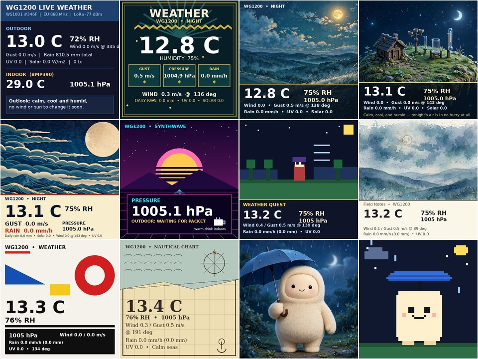
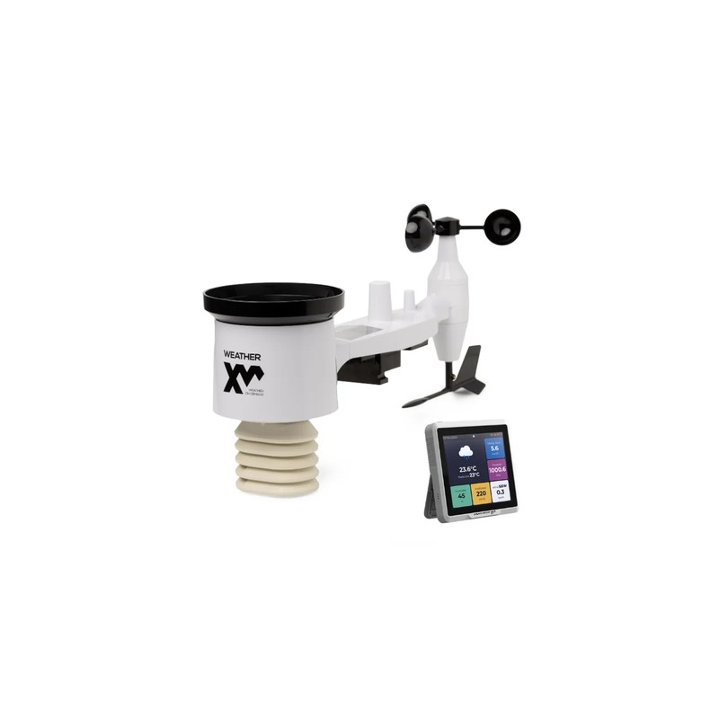
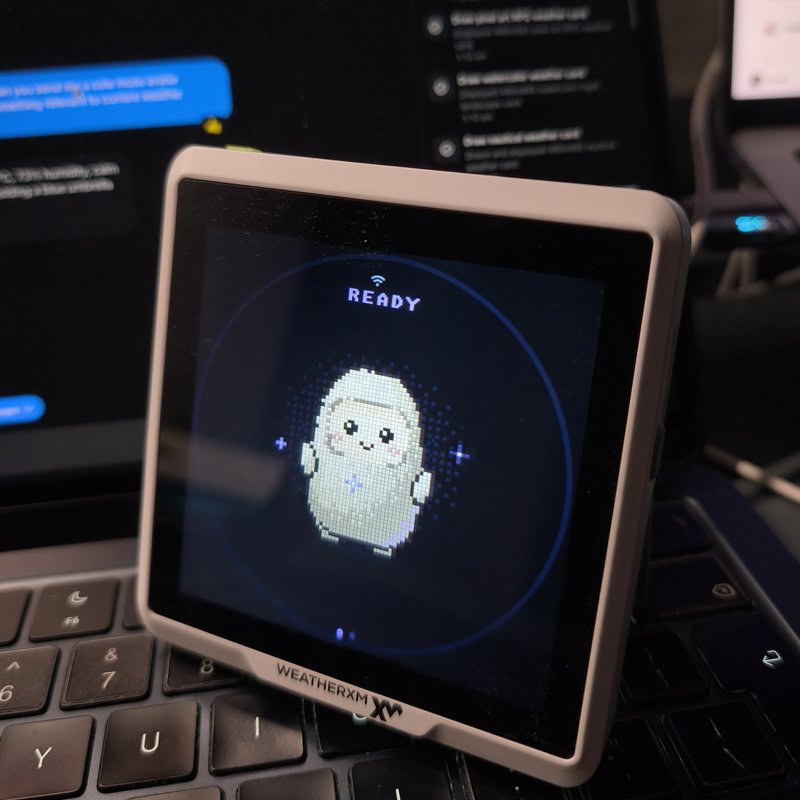

<!--
Copyright (c) Meta Platforms, Inc. and affiliates.

Licensed under the Apache License, Version 2.0 (the "License");
you may not use this file except in compliance with the License.
You may obtain a copy of the License at

    http://www.apache.org/licenses/LICENSE-2.0

Unless required by applicable law or agreed to in writing, software
distributed under the License is distributed on an "AS IS" BASIS,
WITHOUT WARRANTIES OR CONDITIONS OF ANY KIND, either express or implied.
See the License for the specific language governing permissions and
limitations under the License.
-->

# WeatherXM WG1200 (WXM M2 Gateway)

<p align="center">
  
</p>

| [WeatherXM D1 Wi-Fi (`WS1001` + `WG1200`)](https://weatherxm.com/stations/d1-wifi/) | `WG1200` Running Muse Gadget OS (`ota_1` Dual-Boot) |
| :---: | :---: |
| <a href="https://weatherxm.com/stations/d1-wifi/"></a> |  |

The **[WeatherXM WG1200](https://weatherxm.com/stations/d1-wifi/)** (the indoor touchscreen gateway of the **[WeatherXM D1 Wi-Fi Weather Station](https://weatherxm.com/stations/d1-wifi/)**, Seeed OEM variant of the SenseCAP Indicator D1L) is an
ESP32-S3-WROOM-1 (N16R8: 16 MB QSPI flash, 8 MB octal PSRAM) desktop gateway
with a 4.0-inch 480×480 ST7701S RGB565 capacitive touchscreen and a Semtech
SX1262 sub-GHz radio for receiving outdoor WeatherXM weather stations (`WS1001` /
`WS1300`).

## Hardware Differences vs. Seeed SenseCAP Indicator (`WeatherXM-WG1200-v1.1` Schematic)

Although the WG1200 shares the outer enclosure and 4.0" 480×480 RGB565 panel
with the standard Seeed SenseCAP Indicator (`D1`/`D1S`/`D1Pro`), the **WG1200
v1.1 PCB** makes several major hardware changes:

| Subsystem | Seeed SenseCAP Indicator (`sdkconfig.sensecap-indicator`) | WeatherXM WG1200 v1.1 (`sdkconfig.wxm-wg1200`) |
|---|---|---|
| **Flash / Partition Layout** | 8 MB flash (`partitions_8mb.csv`, table at `0x8000`) | **16 MB flash** (`N16R8`), custom bootloader expecting partition table at **`0xC000`** |
| **Secondary MCU (RP2040)** | RP2040 co-processor on UART (`GPIO19`/`GPIO20`) reading SHT4x/SGP40/SCD41 sensors and driving the buzzer/SD slot | **RP2040 and all peripheral circuits removed** (`GPIO19`/`GPIO20` unpopulated) |
| **Indoor Barometer / Temp** | None on ESP32 bus | **Bosch BMP390** (`0x77`) wired directly to the ESP32-S3 Touch/Expander I2C0 bus (`GPIO39` SDA, `GPIO40` SCL), power-gated + I2C-isolated (`Q19`/`Q20`) via `PCA9535 IO1_2` (`BMP_PWR_SW`) |
| **Buzzer (`B1`)** | Driven by RP2040 | Routed to **`PCA9535 IO1_5`** (`BUZZER` net -> NPN transistor `Q7 BC817W` -> `B1` 8.5×8.5×3.0 mm 3.6 V passive electromagnetic SMD buzzer; `R38` to `ESP_GPIO46` is `DNP`). Must be oscillated with an AC square wave over I2C to produce a tone |
| **MicroSD Slot (`J2`)** | Routed to RP2040 SPI | Routed to ESP32-S3 LoRa SPI3 bus (`SCLK=41`, `MOSI=48`, `MISO=47`) with `SD_CS` on **`PCA9535 IO1_3`** and `SD_DET` on **`PCA9535 IO1_4`** |
| **BOOT Button** | `GPIO0` | **`ESP_GPIO10`** (`BOOT`), plus top user button on **`GPIO38`** (active-LOW) |
| **Touch Controller (`FT6336U`)** | Default `homehub` LED backend does not enable touch (`MUSE_ENABLED=n`) | Full LVGL 9 Muse UI + **FT6336U** capacitive touch (`0x48` GX / `0x38` DX, `TP_INT` on `PCA9535 IO0_6`, `TP_REST` on `PCA9535 IO0_7`) |
| **LCD Scan & PCLK Timing** | 16 MHz PCLK, `SDIR=0x00` (`C7=0x00`), no bounce buffers | **12 MHz PCLK**, `PCLK_ACTIVE_NEG=1`, **10-line internal DMA bounce buffers** (`480×10`), and **`C7=0x00` + `36=0x00`** to prevent horizontal mirroring and Wi-Fi/PSRAM bandwidth tearing |
| **Sub-GHz Radio (`SX1262`)** | Unused | **Semtech SX1262** on `SPI3_HOST` (`SCLK=41`, `MOSI=48`, `MISO=47`, shared with ST7701S 9-bit SPI init pins released after panel init; `NSS=IO0_0`, `RST=IO0_1`, `BUSY=IO0_2`, `DIO1=IO0_3`) decoding outdoor `WS1001` & `WS1300` **LoRa WeatherXM P2P** telemetry (`SF7 / BW125 / CR 4/5`) |
| **Audio / Microphone** | None | None (display + touch + passive buzzer; microphone settings hidden in UI) |
| **Bootloader Security** | Unsigned | Production WG1200 2nd-stage bootloader enforces **RSA-3072 Secure Boot V2** image verification on app partitions |

### `U25` (`PCA9535PW`) Pin Map on WG1200 v1.1

| Port / Bit | Schematic Net | Direction | Function |
|---|---|---|---|
| `IO0_0` | `LORA_NSS` | Output | SX1262 SPI Chip Select (active-LOW) |
| `IO0_1` | `LORA_RST` | Output | SX1262 Reset (active-LOW) |
| `IO0_2` | `LORA_BUSY` | Input | SX1262 Busy status |
| `IO0_3` | `LORA_DIO1` | Input | SX1262 IRQ (`DIO1`) |
| `IO0_4` | `LCD_CS` | Output | ST7701S 9-bit SPI Chip Select (active-LOW) |
| `IO0_5` | `LCD_REST` | Output | ST7701S Reset (active-LOW) |
| `IO0_6` | `TP_INT` | Input | FT6336U Touch Interrupt (active-LOW) |
| `IO0_7` | `TP_REST` | Output | FT6336U Touch Reset (active-LOW) |
| `IO1_0` | `RP_RST` | Unused | Unconnected (`RP2040` removed) |
| `IO1_1` | `ECC_PWR_SW` | Unused | ATECC608 power switch (`DNP`) |
| `IO1_2` | `BMP_PWR_SW` | Output | Active-HIGH power & I2C FET enable for `BMP390` (`0x77`) |
| `IO1_3` | `SD_CS` | Output | MicroSD SPI Chip Select (`HIGH` = deselected) |
| `IO1_4` | `SD_DET` | Input | MicroSD Card Detect (`CDN` pin 9, `100K` pull-up) |
| `IO1_5` | `Buzzer` | Output | Drives `Q7` (`BC817W`) -> passive buzzer `B1` |

---

## Non-Destructive Dual-Boot with Production WeatherXM Firmware

Production WG1200 units store their factory X.509 certificate, station identity,
encrypted NVS credentials, and WeatherXM firmware across the first 15.1 MB of the
16 MB flash.

[`partitions_wg1200_dualboot.csv`](../partitions_wg1200_dualboot.csv) preserves
every stock WeatherXM partition at its exact byte offset and installs Muse into
`ota_1` (`0x820000`) with an isolated `muse_nvs` partition (`0xF21000`):

| Partition | Offset | Size | Status |
|---|---|---|---|
| `bootloader` | `0x000000` | `48 KB` | **Untouched** (stock WG1200 bootloader) |
| `partition-table` | `0x00C000` | `4 KB` | Identical stock layout + `muse_nvs` appended at `0xF21000` |
| `esp_secure_cert` | `0x00D000` | `8 KB` | **Untouched** (ATECC608B / X.509 certificate) |
| `nvs` | `0x00F000` | `16 KB` | **Untouched** (encrypted WeatherXM NVS) |
| `otadata` | `0x013000` | `8 KB` | Boot selector (`ota_1` = Muse, `ota_0`/`factory` = WeatherXM) |
| `phy_init` | `0x015000` | `4 KB` | **Untouched** |
| `factory` | `0x020000` | `4 MB` | **Untouched** (WeatherXM factory firmware) |
| `ota_0` | `0x420000` | `4 MB` | **Untouched** (WeatherXM active OTA firmware) |
| `ota_1` | `0x820000` | `4 MB` | **Muse Gadget firmware** (RSA-3072 signed) |
| `nvs_key` | `0xC20000` | `4 KB` | **Untouched** (WeatherXM NVS encryption key) |
| `spiffs` | `0xC21000` | `3 MB` | **Untouched** (WeatherXM SPIFFS data) |
| `muse_nvs` | `0xF21000` | `64 KB` | **Muse isolated NVS** (Wi-Fi, pairing, SDK token, settings) |

### Building, Flashing, and Switching OS

Use [`tools/wg1200_dualboot.sh`](../tools/wg1200_dualboot.sh):

```sh
cd esp32

# 1. Back up stock WeatherXM partitions (bootloader, certs, NVS, nvs_key, otadata)
./tools/wg1200_dualboot.sh backup /dev/cu.usbserial-1110

# 2. Build RSA-3072 signed Muse firmware for WG1200
WXM_SIGNING_KEY=/path/to/secure_boot_signing_key.pem ./tools/wg1200_dualboot.sh build

# 3. Install Muse into ota_1 (0x820000) without touching WeatherXM
WXM_SIGNING_KEY=/path/to/secure_boot_signing_key.pem ./tools/wg1200_dualboot.sh install /dev/cu.usbserial-1110

# 4. Provision your Muse SDK token over USB serial (or in Settings -> Muse -> SDK token)
printf '>sdk_token=mgst_...\n' > /dev/cu.usbserial-1110
```

### Returning to WeatherXM Firmware

You can switch back to the stock WeatherXM firmware at any time with zero data loss:

1. **On-screen UI**: Open **Settings → Reboot to WeatherXM** and tap **Reboot to WeatherXM**.
2. **Physical Button**: Hold the top button (`GPIO38`) for **5 seconds** at boot while the screen shows `"Hold top button to boot WeatherXM..."`.
3. **Over USB**:
   ```sh
   ./tools/wg1200_dualboot.sh boot-weatherxm /dev/cu.usbserial-1110
   ```
   And to boot back into Muse later (without reflashing `ota_1`):
   ```sh
   ./tools/wg1200_dualboot.sh boot-muse /dev/cu.usbserial-1110
   ```
