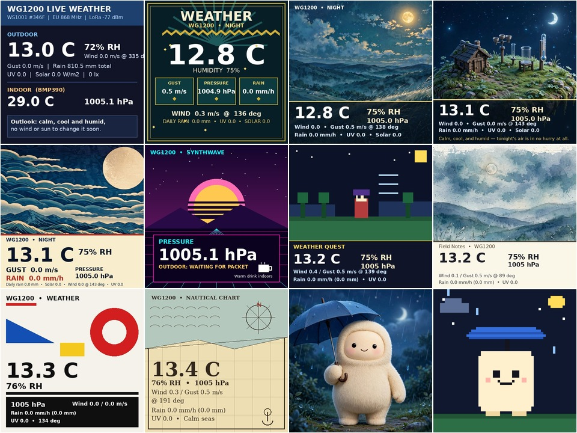
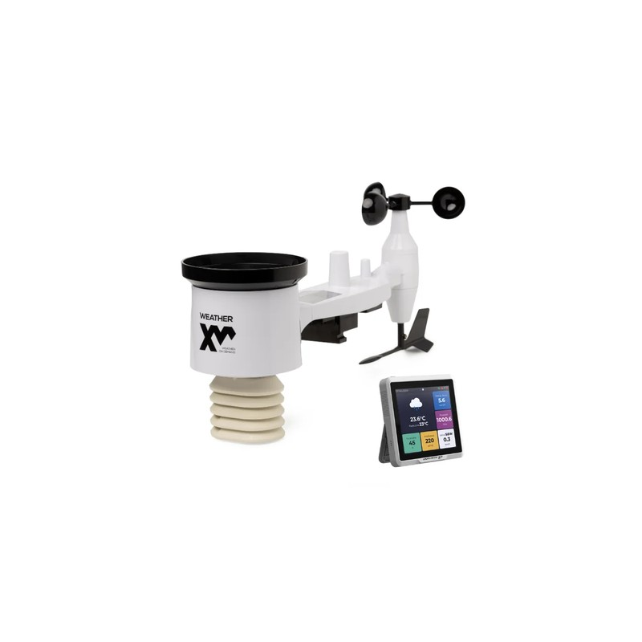
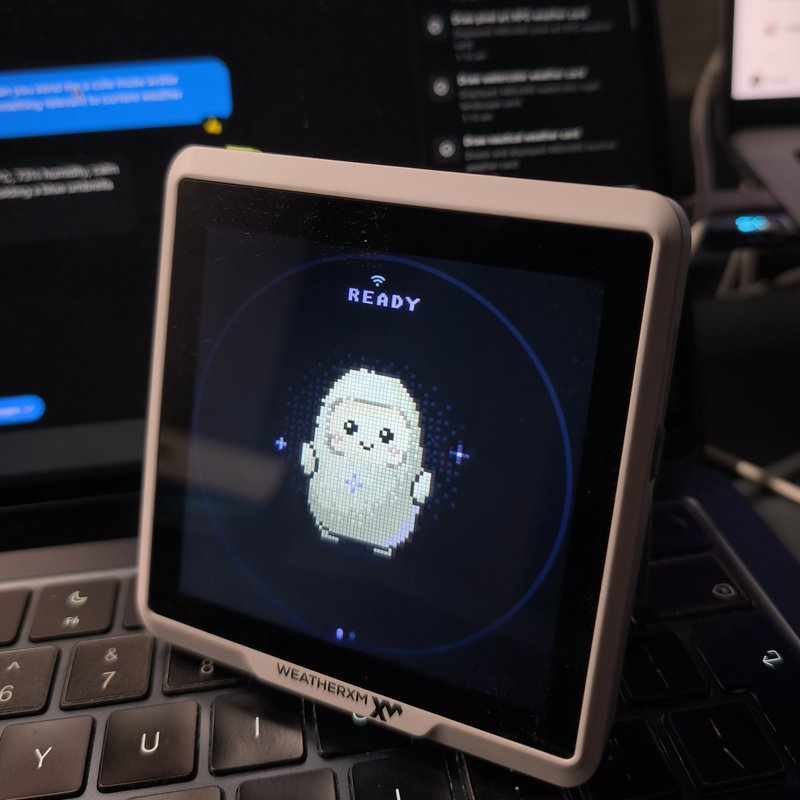

<!--
Copyright (c) Meta Platforms, Inc. and affiliates.

Licensed under the Apache License, Version 2.0 (the "License");
you may not use this file except in compliance with the License.
You may obtain a copy of the License at

    http://www.apache.org/licenses/LICENSE-2.0

Unless required by applicable law or agreed to in writing, software
distributed under the License is distributed on an "AS IS" BASIS,
WITHOUT WARRANTIES OR CONDITIONS OF ANY KIND, either express or implied.
See the License for the specific language governing permissions and
limitations under the License.
-->

# WeatherXM WG1200 (WXM M2 Gateway)

<p align="center">
  
</p>

| [WeatherXM D1 Wi-Fi (`WS1001` + `WG1200`)](https://weatherxm.com/stations/) | `WG1200` Running Muse Gadget OS (`ota_1` Dual-Boot) |
| :---: | :---: |
| <a href="https://weatherxm.com/stations/"></a> |  |

The **[WeatherXM WG1200](https://weatherxm.com/stations/)** (the indoor touchscreen gateway of the **[WeatherXM D1 Wi-Fi Weather Station](https://weatherxm.com/stations/)**, Seeed OEM variant of the SenseCAP Indicator D1L) is an
ESP32-S3-WROOM-1 (N16R8: 16 MB QSPI flash, 8 MB octal PSRAM) desktop gateway
with a 4.0-inch 480×480 ST7701S RGB565 capacitive touchscreen and a Semtech
SX1262 sub-GHz radio for receiving outdoor WeatherXM weather stations (`WS1001` /
`WS1300`).

## Hardware Differences vs. Seeed SenseCAP Indicator (`WeatherXM-WG1200-v1.1` Schematic)

Although the WG1200 shares the outer enclosure and 4.0" 480×480 RGB565 panel
with the standard Seeed SenseCAP Indicator (`D1`/`D1S`/`D1Pro`), the **WG1200
v1.1 PCB** makes several major hardware changes:

| Subsystem | Seeed SenseCAP Indicator (`sdkconfig.sensecap-indicator`) | WeatherXM WG1200 v1.1 (`sdkconfig.wxm-wg1200`) |
|---|---|---|
| **Flash / Partition Layout** | 8 MB flash (`partitions_8mb.csv`, table at `0x8000`) | **16 MB flash** (`N16R8`), custom bootloader expecting partition table at **`0xC000`** |
| **Secondary MCU (RP2040)** | RP2040 co-processor on UART (`GPIO19`/`GPIO20`) reading SHT4x/SGP40/SCD41 sensors and driving the buzzer/SD slot | **RP2040 and all peripheral circuits removed** (`GPIO19`/`GPIO20` unpopulated) |
| **Indoor Barometer / Temp** | None on ESP32 bus | **Bosch BMP390** (`0x77`) wired directly to the ESP32-S3 Touch/Expander I2C0 bus (`GPIO39` SDA, `GPIO40` SCL), power-gated + I2C-isolated (`Q19`/`Q20`) via `PCA9535 IO1_2` (`BMP_PWR_SW`) |
| **Buzzer (`B1`)** | Driven by RP2040 | Routed to **`PCA9535 IO1_5`** (`BUZZER` net -> NPN transistor `Q7 BC817W` -> `B1` 8.5×8.5×3.0 mm 3.6 V passive electromagnetic SMD buzzer; `R38` to `ESP_GPIO46` is `DNP`). Must be oscillated with an AC square wave over I2C to produce a tone |
| **MicroSD Slot (`J2`)** | Routed to RP2040 SPI | Routed to ESP32-S3 LoRa SPI3 bus (`SCLK=41`, `MOSI=48`, `MISO=47`) with `SD_CS` on **`PCA9535 IO1_3`** and `SD_DET` on **`PCA9535 IO1_4`** |
| **BOOT Button** | `GPIO0` | **`ESP_GPIO10`** (`BOOT`), plus top user button on **`GPIO38`** (active-LOW) |
| **Touch Controller (`FT6336U`)** | Default `homehub` LED backend does not enable touch (`MUSE_ENABLED=n`) | Full LVGL 9 Muse UI + **FT6336U** capacitive touch (`0x48` GX / `0x38` DX, `TP_INT` on `PCA9535 IO0_6`, `TP_REST` on `PCA9535 IO0_7`) |
| **LCD Scan & PCLK Timing** | 16 MHz PCLK, `SDIR=0x00` (`C7=0x00`), no bounce buffers | **12 MHz PCLK**, `PCLK_ACTIVE_NEG=1`, **10-line internal DMA bounce buffers** (`480×10`), and **`C7=0x00` + `36=0x00`** to prevent horizontal mirroring and Wi-Fi/PSRAM bandwidth tearing |
| **Sub-GHz Radio (`SX1262`)** | Unused | **Semtech SX1262** on `SPI3_HOST` (`SCLK=41`, `MOSI=48`, `MISO=47`, shared with ST7701S 9-bit SPI init pins released after panel init; `NSS=IO0_0`, `RST=IO0_1`, `BUSY=IO0_2`, `DIO1=IO0_3`) decoding outdoor `WS1001` & `WS1300` **LoRa WeatherXM P2P** telemetry (`SF7 / BW125 / CR 4/5`) |
| **Audio / Microphone** | None | None (display + touch + passive buzzer; microphone settings hidden in UI) |
| **Bootloader Security** | Unsigned | Production WG1200 2nd-stage bootloader enforces **RSA-3072 Secure Boot V2** image verification on app partitions |

### `U25` (`PCA9535PW`) Pin Map on WG1200 v1.1

| Port / Bit | Schematic Net | Direction | Function |
|---|---|---|---|
| `IO0_0` | `LORA_NSS` | Output | SX1262 SPI Chip Select (active-LOW) |
| `IO0_1` | `LORA_RST` | Output | SX1262 Reset (active-LOW) |
| `IO0_2` | `LORA_BUSY` | Input | SX1262 Busy status |
| `IO0_3` | `LORA_DIO1` | Input | SX1262 IRQ (`DIO1`) |
| `IO0_4` | `LCD_CS` | Output | ST7701S 9-bit SPI Chip Select (active-LOW) |
| `IO0_5` | `LCD_REST` | Output | ST7701S Reset (active-LOW) |
| `IO0_6` | `TP_INT` | Input | FT6336U Touch Interrupt (active-LOW) |
| `IO0_7` | `TP_REST` | Output | FT6336U Touch Reset (active-LOW) |
| `IO1_0` | `RP_RST` | Unused | Unconnected (`RP2040` removed) |
| `IO1_1` | `ECC_PWR_SW` | Unused | ATECC608 power switch (`DNP`) |
| `IO1_2` | `BMP_PWR_SW` | Output | Active-HIGH power & I2C FET enable for `BMP390` (`0x77`) |
| `IO1_3` | `SD_CS` | Output | MicroSD SPI Chip Select (`HIGH` = deselected) |
| `IO1_4` | `SD_DET` | Input | MicroSD Card Detect (`CDN` pin 9, `100K` pull-up) |
| `IO1_5` | `Buzzer` | Output | Drives `Q7` (`BC817W`) -> passive buzzer `B1` |

---

## Non-Destructive Dual-Boot with Production WeatherXM Firmware

Production WG1200 units store their factory X.509 certificate, station identity,
encrypted NVS credentials, and WeatherXM firmware across the first 15.1 MB of the
16 MB flash.

[`partitions_wg1200_dualboot.csv`](../partitions_wg1200_dualboot.csv) preserves
every stock WeatherXM partition at its exact byte offset and installs Muse into
`ota_1` (`0x820000`) with an isolated `muse_nvs` partition (`0xF21000`):

| Partition | Offset | Size | Status |
|---|---|---|---|
| `bootloader` | `0x000000` | `48 KB` | **Untouched** (stock WG1200 bootloader) |
| `partition-table` | `0x00C000` | `4 KB` | Identical stock layout + `muse_nvs` appended at `0xF21000` |
| `esp_secure_cert` | `0x00D000` | `8 KB` | **Untouched** (ATECC608B / X.509 certificate) |
| `nvs` | `0x00F000` | `16 KB` | **Untouched** (encrypted WeatherXM NVS) |
| `otadata` | `0x013000` | `8 KB` | Boot selector (`ota_1` = Muse, `ota_0`/`factory` = WeatherXM) |
| `phy_init` | `0x015000` | `4 KB` | **Untouched** |
| `factory` | `0x020000` | `4 MB` | **Untouched** (WeatherXM factory firmware) |
| `ota_0` | `0x420000` | `4 MB` | **Untouched** (WeatherXM active OTA firmware) |
| `ota_1` | `0x820000` | `4 MB` | **Muse Gadget firmware** (RSA-3072 signed) |
| `nvs_key` | `0xC20000` | `4 KB` | **Untouched** (WeatherXM NVS encryption key) |
| `spiffs` | `0xC21000` | `3 MB` | **Untouched** (WeatherXM SPIFFS data) |
| `muse_nvs` | `0xF21000` | `64 KB` | **Muse isolated NVS** (Wi-Fi, pairing, SDK token, settings) |

### Building, Flashing, and Switching OS

#### Option 1 — 1-Click Dual-Boot Web Flasher & BLE Provisioner ([`https://muse.weatherxm.com`](https://muse.weatherxm.com/), Recommended)

The easiest and safest way to run Muse on a retail WG1200 while keeping your
official signed WeatherXM firmware and station identity intact is
**[muse.weatherxm.com](https://muse.weatherxm.com/)** (source in
[`muse-flasher/`](../../muse-flasher/) of
[`WeatherXM/muse-gadget-sdk`](https://github.com/WeatherXM/muse-gadget-sdk)):
open it in desktop Chrome or Edge, connect over USB-C, and install the RSA-3072
signed Muse build into `ota_1` (`0x820000`), switch between Muse and WeatherXM
in ~2 seconds, and provision 365-day tokens over Web Bluetooth with zero local
toolchain.

#### Option 2 — Static ESP Web Tools Flasher ([`https://weatherxm.github.io/muse-gadget-sdk/`](https://weatherxm.github.io/muse-gadget-sdk/) or `http://localhost:8099/web-flasher/`)

The hosted page needs nothing installed: open it in Chrome or Edge and skip to step 2 below. To run it locally instead:

The repository bundles the latest RSA-3072 signed `muse-gadget.bin` (`0x820000`), `partition-table.bin` (`0xC000`), and `otadata_ota1.bin` (`0x13000`) in [`web-flasher/firmware/wxm-wg1200/`](../../web-flasher/firmware/wxm-wg1200/):

```sh
python3 esp32/tools/muse/muse_setup_server.py
```

1. Open **`http://localhost:8099/web-flasher/`** in Google Chrome or Edge.
2. Enter your **Muse SDK token (`mgst_...`)** in Step 1.
3. With **WeatherXM WG1200 (D1 Wi-Fi Gateway — Safe Dual-Boot)** selected in Step 2, click **Connect & install** and pick the WG1200 USB port (`1a86:7523`).
4. Full-chip erase is disabled (`noErase: true` / `new_install_prompt_erase: false`) so stock WeatherXM partitions cannot be erased. When the install dialog closes, the page automatically sends `>sdk_token=mgst_...` over USB serial and reboots into Muse.
5. To switch back to stock WeatherXM OS from the browser at any time, click **Return WG1200 to WeatherXM** on the Web Flasher page (sends `>boot.weatherxm` over Web Serial).

#### Option 2 — CLI (`tools/wg1200_dualboot.sh`)

Use [`tools/wg1200_dualboot.sh`](../tools/wg1200_dualboot.sh):

```sh
cd esp32

# 1. Back up stock WeatherXM partitions (bootloader, certs, NVS, nvs_key, otadata)
./tools/wg1200_dualboot.sh backup /dev/cu.usbserial-1110

# 2. Build RSA-3072 signed Muse firmware for WG1200
#    (versioned from devices/wxm-wg1200.version, e.g. 0.1.0-g1a2b3c4)
WXM_SIGNING_KEY=/path/to/secure_boot_signing_key.pem ./tools/wg1200_dualboot.sh build

# 3. Install Muse into ota_1 (0x820000) without touching WeatherXM
WXM_SIGNING_KEY=/path/to/secure_boot_signing_key.pem ./tools/wg1200_dualboot.sh install /dev/cu.usbserial-1110

# 4. Provision your Muse SDK token over USB serial (or via Web Serial on localhost:8099)
printf '>sdk_token=mgst_...\n' > /dev/cu.usbserial-1110
```

**Versioning.** Upstream builds report `999.0.0` (`esp32/version.txt`, Meta's placeholder for builds that don't take Muse OTA updates). The WG1200 build stamps its own version instead: the semver in [`devices/wxm-wg1200.version`](wxm-wg1200.version), the commit, and `-dirty` for uncommitted changes under `esp32/`, for example `0.1.0-g1a2b3c4`. Bump that file for each release. Muse OTA stays off on the WG1200 either way: [`main/ota.c`](../main/ota.c) refuses any update whose target would be `ota_0` or `factory`.

**Build settings.** Set them in `build-muse-wxm-wg1200/sdkconfig` (or `idf.py -B build-muse-wxm-wg1200 menuconfig`, under Muse):

- `CONFIG_MUSE_WG1200_FORECAST_LOCATION` (default `"Athens"`): where the swipe-down forecast card is for until the outdoor station's GPS fix arrives. Muse decodes the station's `WEATHER_GPS_SIGNED` packets and keeps the last fix in `muse_nvs`; the station sends one only when WeatherXM's firmware asks (a signed ack Muse can't make), so on a fresh install the fallback is used. Preferences you've told Muse (location, providers, time range, style) override both.
- `CONFIG_GADGET_SDK_TOKEN`: keep it `""`. A token set here is compiled into the image, and the flashers serve their images publicly; they send each user's own token over USB instead. `wg1200_dualboot.sh build` and the muse-flasher manifest script both refuse an image with a token in it.

**Swipe-down card prompt.** The request the swipe sends is a template stored in `muse_nvs`, changeable without reflashing from the USB console or the Companion BLE service ([`wg1200_card_prompt.h`](../components/muse/wg1200_card_prompt.h)):

| Command | Effect |
|---|---|
| `card.prompt=TEXT` | Replace the template (empty: back to the built-in one) |
| `card.prompt+=TEXT` | Append a chunk; BLE writes carry ~400 bytes, so longer templates arrive in pieces (max 1023 bytes) |
| `card.prompt?` | Print the template on the console as `@card.prompt {"custom":…,"len":…,"text":"…"}` |

On USB prefix each with `>`. At swipe time `{weather}` becomes the live readings, `{location}` the station's GPS fix (or `CONFIG_MUSE_WG1200_FORECAST_LOCATION`) and `{style}` a random card style. The Web Flasher & Provisioner's setup tab has an editor that does all of this.

---

## Provisioning a Permanent 365-Day Device Token (`provision_v2` + `muse_ble`)

The ESP32 firmware runs **two BLE GATT services** on the same NimBLE stack:
1. **Subsystem B — Home Link (`7fdd3d1c-38ea-46cf-8b46-314ecf5f240c`, [`ble_server.c`](../main/ble_server.c) & [`link_pairing.c`](../main/link_pairing.c)):**
   The main gadget daemon. Requires an ECDH P-256 + HKDF-SHA256 + AES-256-GCM v5 pairing handshake followed by an encrypted `provision_v2` payload carrying a **permanent 365-day device token pair** (`access_token` + `refresh_token`, `token_type: "device"`). Once provisioned, it registers the gadget with your Muse VM (`link.register`), opens the `10.42.0.1` LAN tunnel, and exposes `sensors.read`, `display.draw_url`, `display.draw_file`, `wg1200.notify`, and `device.boot_weatherxm`.
2. **Subsystem A — Companion Setup (`4d757365-0001-4000-8000-6a6f6c6c7900`, [`muse_ble.c`](../components/muse/muse_ble.c)):**
   Configures `hatch.host`, `hatch.vm`, and `hatch.token` in NVS for device-initiated touchscreen turns.

> **Important:** Passing only a short-lived browser session token (`s0:...`) to `ble_setup.html` (`muse_ble`) only configures Subsystem A and **expires quickly** without registering `Home Link` (`link.register`). For a permanent setup, you must mint a **365-day `device` token pair** (`access_token` + `refresh_token`) and pass it through `provision_v2`.

### 1. What You Need to Mint & Pass a Permanent Token (Per Device)

| Requirement | Where to Get It | Per-Account or Per-Device? | How It Is Used |
|---|---|---|---|
| **1. SDK Token (`mgst_...`, 48 chars)** | Create at [`https://gadgets.muse.ai/settings/sdk-tokens`](https://gadgets.muse.ai/settings/sdk-tokens) | **Per-Account** (can be shared across your devices) | Must be stored in the ESP32's NVS over USB Serial (`>sdk_token=mgst_...\n` at `115200` baud, see [`sdk_token_console.h`](../main/sdk_token_console.h)) **and** passed in the JSON body of `POST /device_token/mint`. |
| **2. Device Node ID (`homelink-xxxxxx`)** | Auto-read over BLE (`get_device_info`) or derived from the BLE name `MuseGadget-XXXXXX` | **Unique Per ESP32 Device** (lowercase last 3 bytes of Wi-Fi STA MAC, see [`identity.c`](../main/identity.c)) | Passed as `"device_id": "homelink-xxxxxx"` to `POST https://api.muse.ai/device_token/mint`. **Every physical ESP32 must mint its own token pair using its own `homelink-xxxxxx` ID.** |
| **3. Web User Access Token (`s0:...` / `eyJ...`)** | From a logged-in `https://muse.ai` browser tab (`POST https://muse.ai/api/auth/check`) | **Per-Session** (only needed once at setup time to call `/device_token/mint`) | Used as `Authorization: Bearer <WEB_USER_ACCESS_TOKEN>` when calling `POST https://api.muse.ai/device_token/mint`. |
| **4. Assigned Muse VM ID (`<UUID>`)** | From `GET https://muse.ai/api/session` or `GET https://api.muse.ai/fetch_vms` | **Per-Account VM** | Written to Companion NVS (`hatch.vm=<UUID>`) and verified against `fetch_vms`. |
| **5. 2.4 GHz Wi-Fi `ssid` & `password`** | Your local 2.4 GHz Wi-Fi network | **Per-Location** | Sent inside the encrypted `provision_v2` payload over Home Link BLE. |

---

### 2. Option A — 1-Click Web Bluetooth Provisioner (`http://localhost:8099`)

Because `https://api.muse.ai` does not return browser CORS headers, [`muse_setup_server.py`](../tools/muse/muse_setup_server.py) provides a tiny local HTTP server + CORS proxy on `http://localhost:8099` serving [`muse_full_setup.html`](../tools/muse/muse_full_setup.html):

```sh
python3 esp32/tools/muse/muse_setup_server.py --port 8099
```

Then open **`http://localhost:8099`** in **Google Chrome**:

1. **Write the SDK Token to the New ESP32 (Once per board):**
   Paste your 48-character `mgst_...` token into **SDK Token** and click **Write via USB Serial** (or send `printf '>sdk_token=mgst_...\n' > /dev/cu.usbserial-XXXX`). The ESP32 replies `@sdk_token ok`, saves it in NVS, and reboots.
2. **Grab Your Web User Access Token from `https://muse.ai`:**
   Click **Copy DevTools Token Snippet** on the setup page, paste it into the DevTools Console of your logged-in `https://muse.ai` tab:
   ```js
   fetch('/api/auth/check', { method: 'POST' })
     .then(r => r.json())
     .then(d => { console.log(d.access_token); copy(d.access_token); });
   ```
   and paste the copied token into **Web User Access Token**.
3. **Connect the New ESP32 over Web Bluetooth:**
   Click **Connect ESP32 via Web Bluetooth** and pick `MuseGadget-XXXXXX`.
   - The page automatically queries `{"action":"get_device_info"}` over Home Link BLE, updates **Node ID** to the new device's `homelink-xxxxxx`, and clears any cached token from a previous board so a fresh 365-day token pair will be minted for the new device.
4. **Click `1-Click Full Provision (Home Link + Companion)`:**
   - **Step 1–2:** Performs the P-256 ECDH + HKDF-SHA256 + AES-256-GCM handshake (`pairing_client_hello` → `pairing_ready` → `pairing_client_finished`).
   - **Step 3:** When the orange banner pulses (`confirm_required`), **tap Confirm on the WG1200 touchscreen** (within 60s).
   - **Step 4:** Mints the permanent 365-day `access_token` + `refresh_token` for `homelink-xxxxxx` via `/api/mint` (`POST https://api.muse.ai/device_token/mint`).
   - **Step 5:** Writes `hatch.host`, `hatch.vm`, and chunked `hatch.token` to Subsystem A (`muse_ble`).
   - **Step 6–7:** Sends encrypted `provision_v2` (`token_type: "device"`) to Subsystem B (`Home Link`), waits for `wifi_connecting` → `wifi_connected` → `auth_ok`, marks `setup_complete` in NVS, and reboots into linked VM mode.

---

### 3. Option B — Manual CLI (`curl`) Reference for Minting & Refreshing Permanent Tokens

If you want to mint, refresh, or inspect a permanent 365-day device token pair directly from the terminal (matching [`esp32/main/vm_api.c`](../main/vm_api.c)):

#### A. Mint a 365-Day Device Token Pair (`POST https://api.muse.ai/device_token/mint`)
```sh
curl -sS -X POST "https://api.muse.ai/device_token/mint" \
  -H "Authorization: Bearer <WEB_USER_ACCESS_TOKEN>" \
  -H "Content-Type: application/json" \
  -H "X-API-Version: 1.0.0" \
  -d '{
    "device_id": "homelink-xxxxxx",
    "sdk_token": "mgst_xxxxxxxxxxxxxxxxxxxxxxxxxxxxxxxxxxxxxxxxxxx"
  }'
```
**Response:**
```json
{
  "access_token": "<MINTED_365_DAY_DEVICE_ACCESS_TOKEN>",
  "refresh_token": "<MINTED_365_DAY_DEVICE_REFRESH_TOKEN>"
}
```

#### B. Verify the Minted Device Token & List VMs (`GET https://api.muse.ai/fetch_vms`)
```sh
curl -sS -X GET "https://api.muse.ai/fetch_vms" \
  -H "Authorization: Bearer <MINTED_365_DAY_DEVICE_ACCESS_TOKEN>" \
  -H "X-API-Version: 1.0.0"
```

#### C. Refresh a Device Token Pair (`POST https://api.muse.ai/device_token/refresh`)
The ESP32 automatically calls this endpoint using its stored `refresh_token` in NVS ([`vm_api_refresh_device_token`](../main/vm_api.c#L268-L273)):
```sh
curl -sS -X POST "https://api.muse.ai/device_token/refresh" \
  -H "Authorization: Bearer <MINTED_365_DAY_DEVICE_REFRESH_TOKEN>" \
  -H "Content-Type: application/json" \
  -H "X-API-Version: 1.0.0" \
  -d '{
    "device_id": "homelink-xxxxxx",
    "sdk_token": "mgst_xxxxxxxxxxxxxxxxxxxxxxxxxxxxxxxxxxxxxxxxxxx"
  }'
```

#### D. Exact `provision_v2` JSON Payload Sent Inside the Encrypted Home Link Envelope
In [`esp32/main/ble_server.c`](../main/ble_server.c#L397-L441) and [`esp32/main/app.c`](../main/app.c#L803-L869), `provision_v2` requires all four strings (`ssid`, `password`, `access_token`, `refresh_token`) to be non-empty and `"token_type": "device"`:
```json
{
  "action": "provision_v2",
  "ssid": "<YOUR_2.4GHZ_WIFI_SSID>",
  "password": "<YOUR_WIFI_PASSWORD>",
  "access_token": "<MINTED_365_DAY_DEVICE_ACCESS_TOKEN>",
  "refresh_token": "<MINTED_365_DAY_DEVICE_REFRESH_TOKEN>",
  "token_type": "device"
}
```
When both `access_token` and `refresh_token` are provided with `"token_type": "device"`, [`accept_pairing_credentials()`](../main/app.c#L817-L853) stores both tokens directly in the `muse_nvs` (`config_store`) partition and marks `setup_complete = 1`.

### Top Button Holds

| Hold | Action |
|---|---|
| 1.5 s | Shows `HOLD 5S: RESET MUSE / 10S: WEATHERXM` (release to cancel) |
| 5 s, then release | Resets Muse: unpairs Link, forgets Wi-Fi, clears the Muse token and VM, and restarts ready for 1-click provisioning |
| 10 s | Reboots into the stock WeatherXM firmware without touching Muse's setup |

The reset waits for the release, so holding on to 10 s never resets Muse.

### Reaching LAN Cameras and Local Devices Over the Home Link Tunnel

`sdkconfig.wxm-wg1200` enables the standard Muse Home Link L3 tunnel (`CONFIG_HOMEHUB_TUNNEL=y`, lwIP IPv4 NAPT at `10.42.0.1` over Noise stream 2 in [`noise_tunnel.cpp`](../main/noise_tunnel.cpp) and [`tunnel_netif.c`](../main/tunnel_netif.c)), with TX/RX packet pools pre-allocated in the WG1200's 8 MB octal PSRAM.

1. **Discovery & IPv4 stability:** `device.discover` scans ARP, mDNS, SSDP and ONVIF WS-Discovery (`3702/udp`) from the WG1200 and returns private IPv4 addresses. Because the tunnel routes unicast IPv4 packets (not multicast `.local` mDNS), reserve a static DHCP lease on your router for any camera you pair with Muse.
2. **Per-device user approval:** On first connection from Muse's VM to a LAN IPv4 address (`~/docs/devices/home_link.md`), the user approves that device once in the Muse app. Camera tokens and Basic/Digest credentials stay on the VM.
3. **Capture & `480×480` display handoff:**
   - Thingino cameras expose fast sub-stream JPEG snapshots at `/x/ch1.jpg?token=…` (~40–150 KB) and full-res snapshots at `/x/ch0.jpg?token=…` (plus `/image.jpg` with Basic/Digest auth).
   - RTSP cameras work directly from the VM over TCP-interleaved transport (`ffmpeg -rtsp_transport tcp -frames:v 1`), which clamps TCP MSS cleanly inside `TUNNEL_MTU = 1280` without UDP packet drops.
   - To fill the WG1200 panel without progressive-JPEG (`JDR_FMT3`) errors or `16:9` letterboxing, Muse crops/transcodes on the VM to a `480×480` **baseline** JPEG and renders it via `display.draw_file` (waking the display automatically if asleep).
   - Ready-to-use skills live in [`skills/gadget-thingino-cameras/SKILL.md`](../../skills/gadget-thingino-cameras/SKILL.md) and [`skills/gadget-weatherxm-wg1200/SKILL.md`](../../skills/gadget-weatherxm-wg1200/SKILL.md).

### Returning to WeatherXM Firmware

You can switch back to the stock WeatherXM firmware at any time with zero data loss:

1. **On-screen UI**: Open **Settings → Reboot to WeatherXM** and tap **Reboot to WeatherXM**.
2. **Physical Button**: Hold the top button (`GPIO38`) for **10 seconds**. The Muse setup is kept, so `boot-muse` (below) brings it back as it was.
3. **Over USB**:
   ```sh
   ./tools/wg1200_dualboot.sh boot-weatherxm /dev/cu.usbserial-1110
   ```
   And to boot back into Muse later (without reflashing `ota_1`):
   ```sh
   ./tools/wg1200_dualboot.sh boot-muse /dev/cu.usbserial-1110
   ```
